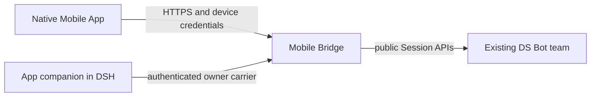

# DS Bot Mobile Bridge

Device authentication and scoped message transport for your existing DS Bot team.

[简体中文](README.md) · [Documentation](docs/README.md) · [Configuration](docs/configuration.md) · [Development](docs/development.md) · [Downloads](https://github.com/MuQY1818/ds-bot-mobile-bridge/releases) · [Issues](https://github.com/MuQY1818/ds-bot-mobile-bridge/issues)

Mobile Bridge is an independent computer-side DSH plugin for [DS Bot Mobile App](https://github.com/MuQY1818/ds-bot-mobile-app). It provides device pairing, scoped authorization, Bot/group text history, message submission and receipts through the existing team's public session APIs.

The current independent plugin preview is **0.0.6**, targeting DSH **0.2.1-rc.2** and a DS Bot installation that provides the compatible Bridge contract. The App repository owns the phone client and computer-side pairing interface. For phone browser access, use [Mobile Web](https://github.com/MuQY1818/ds-bot-mobile-web); Bridge is unnecessary.

## Architecture

## Capabilities

- Pair devices after explicit computer-owner approval; revoke credentials when needed.
- List visible Bots and groups, read paginated text history, receive full messages and recover after reconnecting.
- Submit text using a stable request identity and query receipts; conflicting retries are refused.
- Negotiate explicitly declared model, usage, own-memory, schedule, queue and cancellation operations.
- Project bounded metadata and group history through the upstream known-value redaction contract.

Token-level events, native approval/secret submission, media/voice transport, system push and group administration are outside this release. See [compatibility](COMPATIBILITY.md).

## Install and pair

1. Confirm that DS Bot exposes `bridge.describe`, stable `bridge.submit`, and `bridge.redact`. Pristine npm DS Bot `0.1.7` lacks the complete contract. A separately identified compatible package is available through [App releases](https://github.com/MuQY1818/ds-bot-mobile-app/releases).
2. Download the plugin `.tgz` from [Bridge Releases](https://github.com/MuQY1818/ds-bot-mobile-bridge/releases), then install and enable it in your existing DSH plugin manager on the computer.
3. Configure a dedicated persistent absolute `home`, listener and existing phone-accessible HTTPS endpoint. Follow [configuration](docs/configuration.md); Bridge does not provision tunnels, certificates or a new team.
4. Install the App companion. Open **Phone access → App** on the computer, scan its pairing QR in the native client, then verify and approve the pending device on the computer.

The `.tgz` belongs on the computer. The native phone client remains a self-built source preview; ready-to-install public IPA/APK files are unavailable. Scanning alone does not authorize a device.

## Independent components

| Repository | Responsibility | Required for |
| --- | --- | --- |
| [Mobile Web](https://github.com/MuQY1818/ds-bot-mobile-web) | Browser layout, navigation and Web sign-in | Browser access |
| [Mobile App](https://github.com/MuQY1818/ds-bot-mobile-app) | Native client, SDK and computer pairing interface | Native App access |
| **Mobile Bridge** | Device authentication and scoped HTTP/WebSocket transport | Native App access |

## Updates

Preserve the original Bridge `home` to retain device and receipt identity. Stop the old instance before starting another against the same directory or port. Disabling the companion removes its interface; disabling Bridge stops device transport. Revoke a lost device from the computer's authorized-device list.

## Documentation

| Guide | Purpose |
| --- | --- |
| [Configuration](docs/configuration.md) | Persistent state, TLS, endpoint, pairing and upgrades |
| [Owner API](docs/owner-api.md) | Authenticated management carrier and allowed commands |
| [Architecture](docs/architecture.md) | Boundaries and runtime structure |
| [Compatibility](COMPATIBILITY.md) | Host requirements and capability limits |
| [Validation](docs/validation.md) | Unit, integration and exact-package evidence |
| [Development](docs/development.md) | Independent setup, tests, packaging and CI |
| [Contributing](CONTRIBUTING.md) | Change and reporting requirements |
| [Provenance](docs/provenance.md) | Source commits, attribution and synchronization |

Use Node.js 24. Run `npm ci --ignore-scripts`, `npm run test:prepare`, `npm run check`, and `npm run test:integration` in this checkout. No sibling App/Web checkout, phone, real model key or user DSH profile is required.

## Security and provenance

Pairing material and device tokens belong only to your own devices. Remove credentials, private hostnames and messages from reports. See [SECURITY.md](SECURITY.md).

[Apache License 2.0](LICENSE). Runtime files are extracted unchanged from a fixed App source commit, with the original [NOTICE](NOTICE) retained. DS Bot and character sources are attributed to Fei2411 and contributors. Development SDK, mock and patch inputs are attributed and excluded from the plugin archive. This is an independent community project, unaffiliated with DeepSeek.
