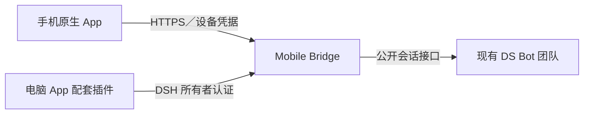

# DS Bot Mobile Bridge

原生 App 与现有 DS Bot 团队之间的设备认证和消息传输插件。

  
  
  

[English](README.en.md) · [文档](docs/README.md) · [安装与配置](docs/configuration.md) · [开发](docs/development.md) · [下载](https://github.com/MuQY1818/ds-bot-mobile-bridge/releases) · [反馈](https://github.com/MuQY1818/ds-bot-mobile-bridge/issues)

DS Bot Mobile Bridge 是安装在电脑 [DeepSeek Harness](https://github.com/deepseek-ai/deepseek-harness)（DSH）中的独立插件，为 [DS Bot Mobile App](https://github.com/MuQY1818/ds-bot-mobile-app) 提供设备配对、受限授权、Bot／群文字历史、消息提交和回执。它使用现有团队的公开会话接口，无需另建团队。

当前版本为 **0.0.6 独立插件预览**，适配 DSH **0.2.1-rc.2** 与提供兼容 Bridge 接口的 DS Bot。这里维护传输服务；手机界面和电脑上的配对管理界面由 App 仓库维护。仅用手机浏览器时，请安装 [Mobile Web](https://github.com/MuQY1818/ds-bot-mobile-web)，无需 Bridge。

## 架构

Bridge 与电脑管理界面独立启停。手机只能访问协商后明确支持的能力，电脑所有者负责批准与撤销设备；团队、Bot 和群会话继续由 DS Bot 管理。

## 能力与边界

| 能力 | 行为 |
| --- | --- |
| 设备配对 | 请求经电脑批准后发放可撤销的设备凭据 |
| 会话与历史 | 可见 Bot／群、分页文字历史、完整消息与重连状态 |
| 稳定提交 | 请求标识、回执查询和冲突重试拒绝 |
| 受限操作 | 按宿主声明提供模型、用量、自己的记忆、日程、队列和取消 |
| 数据边界 | 明确字段投影、群会话作用域与上游已知值脱敏 |

本版不提供逐 token 事件、原生审批或密钥提交、媒体与语音传输、系统推送或群管理。完整能力取决于兼容宿主，详见[兼容说明](COMPATIBILITY.md)。

## 安装与配对

1. **确认宿主兼容。** 现有 DS Bot 需要 `bridge.describe`、稳定 `bridge.submit` 和 `bridge.redact`。原版 npm DS Bot `0.1.7` 缺少完整接口；需要时使用 [App 发布页](https://github.com/MuQY1818/ds-bot-mobile-app/releases)明确标识的兼容包。
2. **安装 Bridge。** 从 [Bridge Releases](https://github.com/MuQY1818/ds-bot-mobile-bridge/releases) 下载 `.tgz` 插件包，在电脑的 DSH 官方插件管理器安装、启用。
3. **配置独立状态与 HTTPS。** 按[配置指南](docs/configuration.md)设置专用绝对 `home`、监听端口和已有的手机可达 HTTPS 地址。Bridge 不创建隧道、证书或公网入口。
4. **扫码并批准。** 安装 App 配套插件，从电脑 **手机访问 → App** 生成配对码；手机扫描后，在电脑核对设备名称并批准。

`.tgz` 安装在电脑上。手机需要 App 仓库提供的原生客户端；目前仍需自行构建，没有公开可直接安装的 IPA/APK。扫码不会自动得到设备权限。

## 三个独立组件

| 仓库 | 职责 | 什么时候需要 |
| --- | --- | --- |
| [Mobile Web](https://github.com/MuQY1818/ds-bot-mobile-web) | 浏览器界面、会话导航、Web 登录入口 | 手机直接用浏览器访问 |
| [Mobile App](https://github.com/MuQY1818/ds-bot-mobile-app) | 原生客户端、SDK、电脑配对与设备管理界面 | 使用原生 App |
| **Mobile Bridge** | 设备认证、受限会话访问、HTTP／WebSocket 传输 | 原生 App 连接电脑 |

## 更新与迁移

保留原 Bridge `home`，其中保存设备与回执身份。先停用旧实例并释放端口，再用同一状态目录启用新包；不要让两个实例同时使用同一目录。停用 App 配套插件只移除管理界面；要停止设备传输，应停用 Bridge。要撤销某台手机，在电脑的已授权设备列表中撤销访问。

## 文档与开发

| 文档 | 内容 |
| --- | --- |
| [安装与配置](docs/configuration.md) | 状态目录、TLS、反向代理、配对、升级 |
| [所有者接口](docs/owner-api.md) | 认证载体与允许的管理命令 |
| [架构](docs/architecture.md) | 服务边界与运行时结构 |
| [兼容与能力](COMPATIBILITY.md) | 适配版本和未提供的功能 |
| [验证范围](docs/validation.md) | 单元、隔离集成、精确包交付的证据边界 |
| [开发](docs/development.md) | 独立依赖、测试、打包与 CI |
| [贡献](CONTRIBUTING.md) | 提交要求与问题报告 |
| [来源](docs/provenance.md) | 原仓库提交、许可与同步方式 |

开发使用 Node.js 24。可在独立 checkout 中执行 `npm ci --ignore-scripts`、`npm run test:prepare`、`npm run check` 和 `npm run test:integration`。无需 App/Web checkout、手机、真实模型密钥或用户 DSH 配置。

## 安全与来源

配对码、完整配对资料和设备令牌只给自己的设备。反馈时使用合成数据，移除凭据、私人域名和聊天内容。漏洞处理见 [SECURITY.md](SECURITY.md)。

[Apache License 2.0](LICENSE)。Bridge 运行时代码从 App 仓库的固定公开提交独立提取，原 [NOTICE](NOTICE) 与来源保留。精灵和上游 DS Bot 代码来自 Fei2411 及贡献者；开发用 SDK、mock 与兼容补丁有明确出处，且不进入插件安装包。本项目是独立社区项目，与 DeepSeek 官方无隶属关系。
