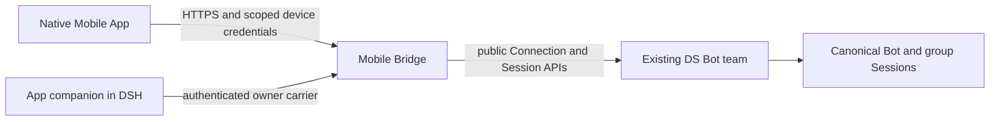

# Architecture

Bridge is a DSH bundle with an independent listener and dedicated state directory. It adapts public host services, projects visible conversations and messages, maintains stable submission receipts, and authenticates device HTTP/WebSocket traffic. It does not render a phone UI or own the team's canonical sessions.

The owner carrier exposes only pairing, status, approval, denial, and revocation. The native App companion renders that management flow in the computer UI. Devices negotiate declared capabilities; the action adapter permits a narrow list of operations and refuses arbitrary host RPC forwarding.

A compatible DS Bot must expose `bridge.describe`, stable `bridge.submit`, and `bridge.redact`. Public npm DS Bot `0.1.7` does not provide that complete contract. Capability denial is explicit; absence of a feature is not replaced with a synthetic response in the production entry.

The packaged runtime lives in `index.mjs` and `src/`. `test-support/` contains only public, attributed development inputs. Runtime extraction provenance is fixed in [source-manifest.json](source-manifest.json).
